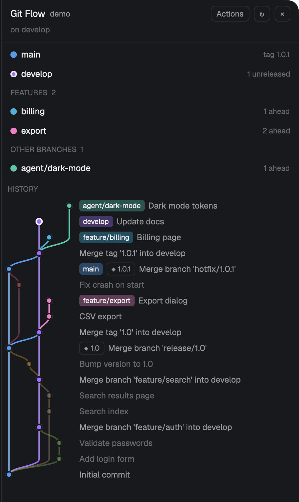
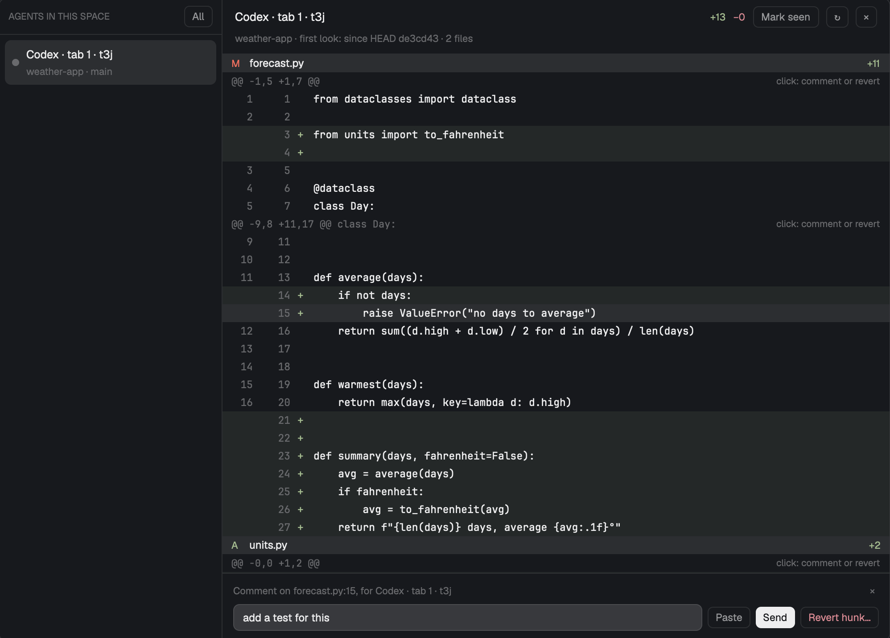

# Herdr mods

Mods for the [Herdr](https://herdr.dev) app, one folder each. Each folder has its `mods/<name>/`, maybe a `keys.json` with the keys it expects, a `RECIPE.md` to build it from scratch, and a `preview.png`.

| Mod | |
| --- | --- |
| [Git Flow](git-flow/RECIPE.md) | The focused terminal's repo as a git-flow graph, drawn from the branches already there (agents' and worktrees' too): smooth colored lanes, a color per branch, and optional actions to start and finish features, releases and hotfixes. Runs `git` only; never pushes. `cmd-shift-g` opens it. |
| [Agent review](agent-review/RECIPE.md) | What an agent (Claude Code, Codex) changed in its repo since you last looked, as a diff. Click a line or hunk to paste a comment into the agent's terminal (Enter only on Send), or revert one hunk after a confirmation. Runs `git` and `hc`; writes only git objects (snapshot trees) into the repo. `cmd-shift-y` opens it. |

## Git Flow

## Agent review

Pick an agent, read what changed since your last **Mark seen**, and comment on a line or hunk. **Paste** puts `forecast.py:15: add a test for this (line: …)` in the agent's input without pressing Enter; **Send** submits it.

Checked by clicking through the running app with Codex and Claude Code agents. Not verified: revert refusing while an agent is working or blocked, because neither Codex nor Claude Code reported a status in Herdr terminals, so revert warns that the agent "may be mid-turn" instead. Repos on another machine are not verified either.

To add one, ask your agent in Herdr to read `~/.config/herdr-app/AGENTS.md` ("Layouts and mods other people made"), then point it at the folder.

Layouts live in [herdr-layouts](https://github.com/jkuepker/herdr-layouts).

## Licence

MIT (see `LICENSE`).
