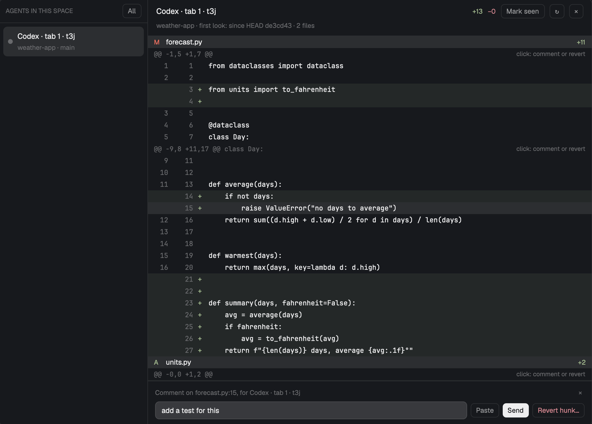

# Agent review

A window that shows what an agent (Claude Code, Codex, any agent running in a Herdr terminal) changed in its repo since you last looked. On the left is a list of the agents in the space; on the right, the picked agent's diff. Click a line or a hunk to write a comment: **Paste** puts it in that agent's terminal without pressing Enter, **Send** submits it. **Mark seen** saves where you are, so the next look shows only what changed after it. **Revert hunk…** undoes one hunk in the working tree, after a confirmation.

## What you see

A 1000×720 window (`mod.json`: `place: none`, opened with `mod.open`). It uses the theme's colors (`theme()`): background, foreground, muted, dim, border, hover, selected, raised, solid, blocked and `ansi1`–`ansi4`.

1. **Agent list**, 250px on the left, with a 1px border on its right.
   - A 40px header: `AGENTS IN THIS SPACE` (or `ALL AGENTS`) in 10.5px semibold dim capitals, and a button, `All` or `This space`, that switches between the two.
   - One row per agent: an 8px status dot, the agent's name in 12.5px, and under it in 11px dim the folder's name and branch (with the space's name first when listing all spaces).
   - The name is `<program> · tab <tab name> · <terminal address>`, so two agents of the same program in one repo can be told apart.
   - The picked row has the `selected` background.
2. **Header** of the diff, with a 1px border under it:
   - The agent's name in semibold, `+N` in green (`ansi2`) and `−N` in red (`ansi1`), and three 24px buttons: `Mark seen`, `↻` and `×`.
   - Under them, in 11px dim: `<repo> · <since what> · N files`. "Since what" is `first look: since HEAD <short hash>`, `since you looked 3 min ago`, or `your last look is gone from the repo (git gc): since HEAD …`.
3. **Shared-repo banner**, shown only when another listed agent works in the same repo on the same machine: `Also working in this repo: <names>. Lines can't be told apart by agent, so this is everyone's changes.` in the `blocked` color on `raised`.
4. **Diff**, a virtual list with 20px rows:
   - A file row on `raised`: `A`, `M` or `D` (`ansi2`, `blocked`, `ansi1`), the folder in dim and the file name in semibold, then `+N` and `−N`.
   - A hunk row: the `@@ … @@` header in 11px monospace dim, and `click: comment or revert` on the right.
   - A line row in monospace: old and new line numbers (34px each, right-aligned, dim), the `+`/`-` sign, and the text. Added lines are tinted green and removed lines red (the color at 18 hex alpha).
   - A binary file or a mode-only change gets one dim row saying it can't be reverted here.
   - Past 4 MB of diff, a dim line says `The diff is too large: showing its first 4 MB.`
5. **Footer**, shown when there is something to say:
   - **Comment box**, after a line or hunk is clicked: the note of the last action (if any) on top, then `Comment on <file>:<line>, for <agent>` with `×`, then a text field (`Comment for the agent`) and buttons `Paste`, `Send` (primary) and `Revert hunk…` (red, or dim when revert isn't allowed). The note sits above the field so the buttons don't move when it appears.
   - **Revert question**: `Revert this hunk in <file> (+N −N)? The file in the working tree changes; <agent> isn't told.` with `Revert` (primary) and `Cancel`. When the agent reports no status it adds `It reports no status, so it may be mid-turn.`
   - **Note**: the result of the last action, green or red; a click clears it.
6. **Empty states**: `Pick an agent.`, `Reading its changes…`, `Nothing changed since then.`, `This agent has no folder.`, `<folder> is not in a git repository.`, `That agent has gone.`

## How it behaves

- **Agents.** Terminals that report a status (`agents()`), plus panes whose program is a known agent (`knownAgents()`) that doesn't report one, such as Codex. On open it picks the focused terminal's agent if it is listed, else the first.
- **Statuses.** The dot is blue (`ansi4`) while working, red (`ansi1`) when blocked, green (`ansi2`) when done, dim when idle or unknown. When the picked agent goes from working to anything else, the diff is read again.
- **Snapshots.** "What it changed" is a diff between two snapshots of the working tree, each saved as a git tree: untracked files included, ignored ones left out.
  - A snapshot runs `git add -A` and `git write-tree` against a throwaway index (a copy of the repo's), so the repo's own index is never touched.
  - The diff reads again on open, on picking an agent, on `↻`, after Mark seen or a revert, and when the agent stops working. Never on a timer: each snapshot writes git objects.
- **Mark seen** saves the current snapshot in `shared("agent-review.seen")` under `<machine>|<repo>|<terminal>`, with the time. The next look diffs against it. The first look diffs against HEAD. If `git gc` has pruned the saved tree, it falls back to HEAD and says so.
- **Comments.** Clicking a line or a hunk header aims the comment box at it and focuses the field. The text sent is:
  - a line: `<file>:<line>: <comment> (line: \`<code>\`)`, or `<file> (removed line N): …` for a removed line;
  - a hunk: `<file>:<first>-<last>: <comment>`.
- **Paste** (or Enter in the field) focuses the agent's pane (`agent.focus`, `pane.focus`), checks 300 ms later that focus got there, puts the text on the clipboard, and runs `terminal.paste`. Your clipboard comes back 1.5 s later if it still holds the comment. If focus didn't move, the comment is left on the clipboard and the note says so.
- **Send** after a Paste of the same text only presses Enter (`hc keys <terminal> enter`), so it isn't typed twice. Otherwise it runs `hc send <terminal> <text>`. It then clears the field.
- **Revert hunk…** asks first, then checks the hunk still applies (`git apply -R --check`) and applies it in reverse to the working tree only. It is refused, with the reason in the note, when:
  - the repo is on another machine;
  - the agent is working or blocked.
- **`×`** closes the window (`closeOverlay`). **`cmd-shift-y`** (`keys.json`: `mod.open:agent-review`) opens it.
- **Commands** for keys or `herdr-app do agent-review.<command>`: `close`, `reload`, `seen`.

## Built from

- `mods/agent-review/` holds these files:
  - `main.js`: the window.
  - `review.js`: the git work (snapshot, diff parsing, revert), plain functions that take `run(command, args) → {code, stdout, stderr}`.
  - `test/review.test.mjs`: checks `review.js` against real git.
  - `mod.json`: `{"place": "none", "title": "Agent review", "overlay": {"kind": "window", "width": 1000, "height": 720}}`.
- **`herdr` calls:** `spaces`, `panes`, `focused`, `agents`, `terminals`, `knownAgents`, `exec`, `hc`, `theme`, `settings`, `run` (`agent.focus`, `pane.focus`, `terminal.paste`), `shared`, `setShared`, `appHome`, `props`, `closeOverlay`, `nextCommand`.
- **gpui-kit:** `View`, `div`. **gpui-base:** `v_flex`, `h_flex`, `InputState`, `Input`, `Scrollbar`, `v_virtual_list`.
- **Programs:** `git`, `sh` (the snapshot script), `mkdir`, and `hc`. It reads no files outside the repo and its own data folder, and makes no network calls.
- **Writes:** git objects in the repo (the snapshot trees, as `git stash` does), nothing else: no refs, no config. The throwaway index lives in `data/agent-review/` for local repos and in the repo's git folder for repos on other machines, and is removed after each snapshot.

## Watch out

- Rows of a virtual list can't hold click handlers. Clicks come through the list's `on_item_click`.
- Codex (and, in some setups, Claude Code) reports no status in a Herdr terminal. Then the view doesn't re-read when its turn ends (use `↻`), and revert can't tell if it is mid-turn: the question warns instead of refusing.
- `terminal.paste` pastes into the focused terminal, so the agent's pane must be focused first, and the clipboard is borrowed for 1.5 s.
- Pasted mid-turn, Codex keeps the comment in its input; Enter hands it to the running turn.
- Lines can't be told apart by agent. Two agents in one repo see the same diff, with the shared-repo banner.
- Herdr's `+` menu can't take extra items. Adding "Agent review" there means cloning Herdr's `tabs` and `new-menu` mods (`mod.clone`) and adding a row that runs `mod.open:agent-review`.
- Diffs past 4 MB are cut at a file boundary, and the list stops at 20 000 rows.

## Done when

1. `node mods/agent-review/test/review.test.mjs` prints `all agent-review checks passed`. It covers snapshots with untracked and ignored files, the since-last-look diff, revert of one hunk, new, deleted, binary and mode-only files, and the repo's index left alone.
2. `herdr-app check mods/agent-review` passes.
3. With a Codex agent that edited a file, `cmd-shift-y` opens the window with its diff since HEAD. After Mark seen and one more edit, only the new edit shows.
4. A line comment's Paste lands in the agent's input as `<file>:<line>: <comment> (line: …)` without being submitted; Send then submits it.
5. Revert hunk… on an idle agent puts the file back to its last-seen state and leaves other files alone.

Not verified: the revert refusal while an agent is working or blocked, because neither Codex nor Claude Code reported a status in Herdr terminals when it was checked. Repos on other machines.
