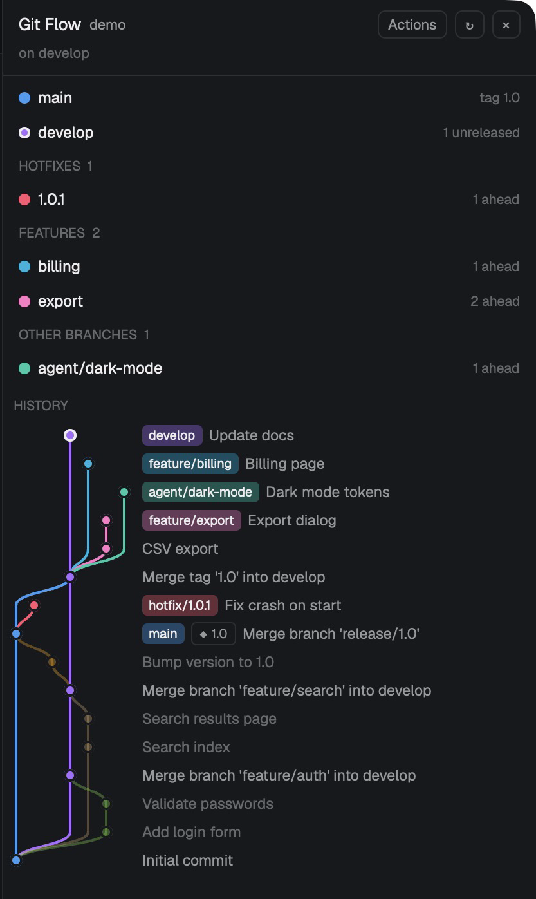

# Git Flow

A panel showing the repo of the focused terminal as a git-flow graph, in the style of GitKraken's Git Flow panel. It is drawn from whatever branches already exist, including ones an agent or a worktree made, so nothing needs setting up first. At the top is a list of branches, each with the count of commits it has that its base lacks. Below that is the history: one smooth colored lane per branch, curving off where the branch starts and back in where it merges. A header button turns on actions: set git flow up, start and finish features, releases and hotfixes, and check out a branch.

## What you see

The panel is 300px wide on the right of the window (`mod.json`: `place: right`). Opened with `mod.open` outside a layout block, it is its own 340×640 window. It uses the theme's colors (`theme()`): background, foreground, muted, dim, border, hover, selected, raised and solid.

1. **Header**, with a 1px border under it. From left to right:
   - `Git Flow` in semibold.
   - The repo folder's name in 11px muted, truncated.
   - Three 22px buttons: `Actions` (filled with `solid` while actions are on), `↻` and `×`.
   - Under them, an 11px status line: `on <branch>`, then `· N changed` or `· merge in progress` (in the theme's `blocked` color), then `· git flow not set up` when the repo has no `gitflow.*` keys.
2. **Body**, which scrolls:
   - **Actions box**, shown only while actions are on. See How it behaves.
   - **Branch list.** Production first, then develop, then a heading and rows for each kind: `HOTFIXES n`, `RELEASES n`, `FEATURES n` and `OTHER BRANCHES n` (anything without a git-flow prefix).
     - Headings are 10.5px semibold dim capitals.
     - Each row is 26px: a 9px dot in the branch's color, the name (the feature or release name without its prefix), and an 10.5px dim detail on the right.
     - The detail is `N ahead` or `no commits`. For production it is `tag <latest>` or `no tags`; for develop, `N unreleased` or `released`; for a missing branch, `missing`.
     - The checked-out branch's dot has a 2px foreground ring and its name is semibold.
     - Each kind lists 12 branches, then a `N more` link in the accent color.
   - **History**, under a `HISTORY` heading.
     - It shows the last 150 commits of all local branches, newest first, at 22px per row.
     - Lanes are 14px columns at the left, at most 8. Each commit is a 10px dot ringed 2px in the background color (in the foreground color at HEAD), so lines stop at the dot.
     - After the lanes come name tags at the commit: a branch tag is its color at 35% with foreground text, and a tag is outlined, like `◆ 1.0`. Last is the subject in 11.5px muted, truncated.
3. **Note bar**, shown only after an action: an 11px message at the bottom, green (`ansi2`) for success or red (`ansi1`) for an error.

**Colors.** Some kinds have one fixed color:

| Kind | Color |
| --- | --- |
| Production | blue `#3d9df3` |
| Develop | purple `#a66cff` |
| Releases | amber `#f5a623` |
| Hotfixes | red `#ff5470` |

Features and other branches each get their own color from this palette: `#1ec9a8 #7bd34a #00b4e0 #ff7ac6 #ffd23f #6c8cff #e05cff #c9a26b`.
- A branch gets the color its name hashes to, unless another branch already has it. Then it takes the next free one.
- Live branches pick first, top of the graph down, then branches already merged and deleted.
- A branch keeps the same color in the list, its lane and its name tag.
- Lanes of merged-and-deleted branches are drawn at 35% opacity. When a branch is picked, every other lane is.

**Lane order**, left to right, as in git-flow's diagram: production, hotfixes, releases, develop, features, others. A lane reuses a column once an earlier lane in it has ended, so two features alive at the same time get two columns.

## How it behaves

- **Which repo.** It follows the focused terminal's folder, on its machine (`exec` with `on`), and redraws when focus moves.
  - It reads again when anything under the repo's git folder changes (`watchFolder` on `git rev-parse --git-common-dir`), and every 10 s.
  - Reads pass `--no-optional-locks -c core.fsmonitor=false -c diff.autoRefreshIndex=false`, so a read writes nothing under `.git` and doesn't trigger its own watch.
- **Production and develop names.** It uses the saved `gitflow.branch.master` and `gitflow.branch.develop` names if there are any. Otherwise production is `main`, or `master` if only that exists, and develop is `develop` if it exists. Prefixes come from `gitflow.prefix.*`, defaulting to `feature/ release/ hotfix/`.
- **Which lane a commit sits in.** Each branch's first-parent line claims its commits, in this order: production, develop, releases, hotfixes, features, others.
  - Commits left over came in through merges of branches since deleted. Each such line gets its own lane, named from the merge subject (`Merge branch 'feature/x'`, `Merge pull request #n from owner/x`).
  - A lane starts at the commit it forked from. It bends there in a cubic S over one row, and bends again into the merge commit over one row.
  - A detached HEAD with no branch is drawn as `HEAD`.
- **Clicks.** Clicking a branch row, or a commit in a live lane, picks that branch: its row is highlighted (`selected`) and the other lanes fade. Clicking it again un-picks it.
- **Actions**, toggled by `Actions` and remembered in `shared("git-flow.actions")`, default off:
  - **Set up git flow**, shown when there are no saved keys or no develop branch. It has Production and Develop name fields, pre-filled with the guesses, and a primary button.
    - It writes the `gitflow.*` keys, the same ones the `git flow` (AVH) tool uses.
    - It makes develop from production if develop is missing, then checks out develop.
  - **Start**: `+ feature`, `+ release` and `+ hotfix` buttons in their colors. One opens a name field with the prefix before it; Enter or `Start` runs `git checkout -b <prefix><name> <base>`. Hotfixes start from production, the others from develop.
  - **On the picked branch:** `Check out` (unless it is HEAD). For a feature, release or hotfix there is also `Finish`, which first asks `Finish <branch>? It …` with Yes and No.
    - A feature merges `--no-ff` into develop.
    - A release or hotfix merges into production, gets a tag named after it (with the `versiontag` prefix), and the tag merges back into develop.
    - The branch is then deleted.
    - Finish refuses while there are uncommitted changes or a merge is in progress. After a conflict, the person resolves it and commits in a terminal, then clicks Finish again.
  - Nothing is ever pushed.
- **`↻`** reads the repo again.
- **`×`** closes the panel. When docked in a layout block it runs `layout.hide {id}` on its block; as a window, it runs `closeOverlay`.
- **`cmd-shift-g`** (`keys.json`: `mod.open:git-flow`) opens the panel as a window from any layout.
- **Empty states:**
  - `No folder here. Focus a terminal in a git repository.`
  - `<folder> is not in a git repository. Focus a terminal in one.`
  - `This repo has no commits yet: the graph shows once it has one.`

## Built from

- `mods/git-flow/` holds these files:
  - `main.js`: the view.
  - `flow.js`: all git work and the graph layout, plain functions that take `git(args) → {code, stdout, stderr}`.
  - `test/flow.test.mjs`: checks `flow.js` against real git.
  - `mod.json`: `{"place": "right", "size": 300, "title": "Git Flow", "overlay": {"kind": "window", "width": 340, "height": 640}}`.
- **`herdr` calls:** `spaces`, `panes`, `focused`, `exec`, `watchFolder`, `theme`, `run` (`layout.hide`), `layout`, `shared`, `setShared`, `props`, `closeOverlay`.
- **gpui-kit:** `View`, `div`, `PathBuilder`, and `window.paint_path` for the lanes: one stroked path (2px) per lane, painted in an absolutely positioned layer over the rows.
- **gpui-base:** `v_flex`, `h_flex`, `InputState`, `Input`.
- **Programs:** only `git`. It reads no files outside its own folder and makes no network calls.
- **Graph layout** (`flow.history`):
  1. `git log --topo-order -n150 --format=%H%x1f%P%x1f%s%x1f%D` over every `refs/heads/*`.
  2. Lanes claim commits by first-parent chains.
  3. Links are forks (`from` lane, at the fork row) and merges (at the merge commit's row).
  4. Columns are picked per kind group, as the first column free over the lane's whole span.

## Watch out

- Herdr's `+` menu can't take extra items. Adding "Git Flow" there means cloning Herdr's `tabs` and `new-menu` mods (`mod.clone`), pointing the cloned tab bar's `+` at the cloned menu, and adding a row that runs `mod.open:git-flow`. Clones don't get Herdr's updates to those mods.
- To dock the panel, add a block `{"id": "git-flow", "type": "block", "content": {"mod": "git-flow"}}` to a layout. A `layout:<name>` key with `layout.toggle:git-flow` then shows and hides the block. In such a layout, a global `mod.open:git-flow` still opens a separate window.
- History is capped at 150 commits and 8 columns: lanes past the 8th share the last column. Each kind reads at most 50 branches.
- Only local branches are drawn. Remote-tracking branches aren't.
- On a very large repo, the first draw of the graph can take a moment; while it does, Herdr may show "could not be re-rendered … interrupted" once, and then the panel recovers on its own.

## Done when

1. `node mods/git-flow/test/flow.test.mjs` prints `all git-flow checks passed`. It covers setup, start and finish of features, releases and hotfixes, a conflict resume, graph lanes and columns, branches with no prefix, and a detached HEAD.
2. `herdr-app check mods/git-flow` passes.
3. In a repo with only `main` and an agent's branch, never set up, the panel draws both lanes and says `git flow not set up`, with no setup screen in the way.
4. A merged and deleted `feature/x` keeps a faint lane named `feature/x`, curving off develop and back into the merge commit.
5. `cmd-shift-g` opens the window; `×` closes it.
